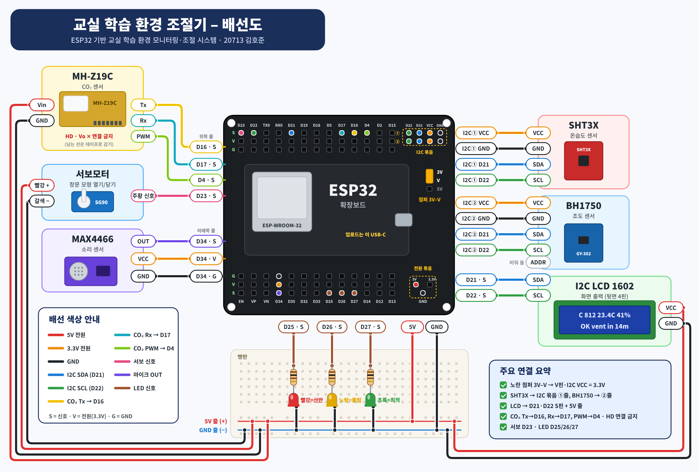

# 교실 학습 환경 조절기

다중 센서와 인공신경망을 활용한 실시간 교실 학습 환경 조절기
20713 김호준 · 2026 인공지능 융합 프로젝트 (SDGs 4 양질의 교육 · 3 건강과 웰빙)

소리·CO₂·조도·온도·습도로 교실의 학습 상태를 **최적 / 졸림 / 산만** 중 하나로 판단해
신호등과 LCD로 알려주고, 웹앱에서 실시간으로 확인·조절합니다.

```
센서 ─▶ ESP32 (10분 특징 → 판단) ─▶ 신호등 · LCD · 서보모터(창문 모형)
              │
              ▼ 10초마다
        Firebase Realtime DB ◀──▶ 깃허브 페이지 웹앱 (상태 확인 · 라벨 기록 · 원격 조절)
              │
              ▼
        tools/export_csv.py ─▶ data/raw/*.csv ─▶ 전처리 · 모델 학습 (노트북)
```

## 폴더 구조

| 경로 | 내용 |
|---|---|
| `firmware/classroom_env/` | ESP32 아두이노 코드 (`classroom_env.ino`, `config.example.h`) |
| `app/index.html` | 웹앱 (깃허브 페이지로 공개) |
| `tools/export_csv.py` | Firebase → CSV 내려받기 |
| `tools/export_mlp.py` | (참고) 상태 분류 MLP → C 헤더 변환 도구 |
| `analysis/` | 분석 노트북 01~06 (실행 결과 포함) — 아래 '분석' 참고 |
| `data/raw/` | 원본 CSV: `logs_*.csv`·`labels_*.csv`(이 장치, 11/14~15), `datasci_7ban_co2_main.csv`(7반 교실 1분 CO₂·창문, 11/2~11/6), `mic_fft_test_*.json`(소리 종류별 주파수 특징 검증 실험) |
| `data/processed/` | 전처리 결과 (`records_clean.csv`, `labeled.csv`, `co2_1min.csv`), 학습한 모델 |
| `results/` | 결과 그림·표 |
| `docs/prompt_log.md` | 생성형 AI 프롬프트 개선 기록 · 최적 조건 탐색 결과 |

## 분석 (analysis/)

| 노트북 | 내용 | 주요 결과 |
|---|---|---|
| `01_preprocess` | 예열·범위 밖 값 제거, UART↔PWM 검증, 날숨 급등 보정, 측정 공백·빈 방 구간, 10분 특징, 라벨 연결 | 두 방식 CO₂ 평균 절대 차이 0.8ppm, r = 1.000 (8,518개) |
| `02_co2_forecast` | 10분 뒤 CO₂ 예측: 그대로 유지 / 직선 연장(기존 펌웨어) / 선형회귀(경사하강 손계산) / k-NN 회귀 / 랜덤 포레스트 회귀 / **MLP** — 하루씩 빼서 평가 | CO₂ 상승 중 오차 MLP 213.9ppm (유지 대비 −12%, 기존 대비 −11%), 헤시안 고윳값으로 학습률 상한 2/λmax 확인 |
| `03_state_classifier` | 학습 상태 분류: 기존 규칙 / k-NN / 결정 트리 / 로지스틱 / SVM / 랜덤 포레스트 / 그레이디언트 부스팅 / **MLP**, 주파수 특징 유무 비교 — 라벨 하나씩 빼서 평가 | 규칙 정확도 9.1% → MLP 56.4%(주파수 특징 포함), 라벨 단위 66.7% |
| `04_optimal_conditions` | 교실 시간대별 CO₂, 창문 개수별 환기 속도, 신경망 '최적' 확률 지도, **k-평균 군집**(라벨 없이 환경 상태 나누기) | 창문 3개 이상일 때만 평균 46ppm/분 감소, 최적 확률 70% 경계 약 2100ppm |
| `05_sound_autoencoder` | 소리 AI: 24시간 소리 특징 7개로 '평소 소리'를 배운 오토인코더(7→8→3→8→7), 복원 오차 = 소음 부담 | 학습에서 뺀 실험에서 조용 0.26 vs 말소리·백색소음·휘파람·키보드 0.97~1.0, '산만' 구분 AUC 규칙 0.673 → 0.785 |
| `06_export_to_esp32` | 상태 분류 신경망의 학습 범위 밖 쏠림 확인, 환경 부담 점수 설계, CO₂ 예측 신경망·소리 AI → `co2_weights.h`·`snd_weights.h`, 장치 계산 검증 | 장치식 계산과 파이썬 차이 최대 0.00002ppm(CO₂), 0.0000007(소리) |

---


### 와이파이 (여러 곳 자동 연결)
- `config.h`의 `WIFI_LIST`(기본 와이파이)와 웹앱 **장치 와이파이 관리**에서 추가한 와이파이 중 신호가 가장 센 곳에 자동 연결합니다.
- 웹앱에서 추가하면 Firebase `/wifi`에 저장되고(규칙상 쓰기 키 없이는 읽기 불가), 장치가 인터넷에 연결돼 있을 때 1분마다 받아서 내부에 저장합니다. 그래서 **새 장소에 가기 전에 미리 추가**해 두면 됩니다(최대 8개).
- 비상용: 아무 와이파이에도 연결되지 않은 채 1분이 지나면 설정용 와이파이 `ENV-<BOARD_NAME>`(비밀번호 = `PORTAL_KEY`)이 켜지고, 접속하면 그 자리에서 추가할 수 있는 페이지가 열립니다.

## 1. 배선 (ESP32-WROOM-32 30핀 + 확장보드)



노란 점퍼는 **3V–V** 로 꽂습니다. 그러면 각 핀의 V 줄과 I2C 묶음 VCC가 모두 3.3V가 됩니다.

| 부품 | 연결 |
|---|---|
| SHT3X (온습도) | 보드 **I2C 묶음 ①줄**에 바로: VCC·GND·SDA(D21)·SCL(D22) |
| BH1750 (조도) | 보드 **I2C 묶음 ②줄**에 바로 (ADDR은 비워 둠) |
| I2C LCD | SDA → **D21 S**, SCL → **D22 S**, VCC → 빵판 **5V 줄**, GND → 빵판 GND 줄 |
| MAX4466 (소리) | **D34**의 S(OUT)·V(VCC)·G(GND) |
| MH-Z19C (CO₂) | Vin → 5V 줄, GND → GND 줄, Tx → **D16 S**, Rx → **D17 S**, PWM → **D4 S** (HD·Vo 연결 금지) |
| 서보모터 | 주황(신호) → **D23 S**, 빨강 → 5V 줄, 갈색 → GND 줄 |
| 신호등 LED | D25/D26/D27 S → 저항 → LED 긴 다리, 짧은 다리 → GND 줄 |
| 빵판 레일 | 보드 전원 묶음 **5V → + 줄**, **GND → − 줄** |

- I2C 장치 3개(LCD, BH1750, SHT)는 SDA·SCL(D21·D22)을 함께 씁니다. 주소가 서로 달라서 충돌하지 않아요(0x27 / 0x23 / 0x44).
- 온습도 센서는 ESP32·CO₂ 센서의 열을 피해 조금 떨어뜨리고, 조도 센서는 면이 천장을 향하게 둡니다.
- 서보가 움직일 때 ESP32가 재부팅되면 USB 전원이 부족한 거예요. 서보 5V·GND 사이에 100µF 이상 콘덴서를 달거나 5V 2A 어댑터를 쓰세요.
- MAX4466 뒷면의 작은 가변저항은 증폭률입니다. 조용할 때 `snd_mean`이 너무 작으면(20 이하) 시계 방향으로 돌려 키우세요.

## 2. Firebase 준비 (처음 한 번)

1. [Firebase 콘솔](https://console.firebase.google.com)에서 프로젝트 만들기
2. **빌드 → Realtime Database → 데이터베이스 만들기** (위치: 싱가포르 `asia-southeast1`, 잠금 모드)
3. **규칙** 탭에 아래를 붙여넣고 게시. 측정값·라벨·설정은 공개 읽기(웹앱·선생님 확인용), 쓰기는 비밀번호가 있어야 가능. 와이파이 목록(`/wifi`)은 비밀번호 없이는 읽을 수도 없음.
   ```json
   {
     "rules": {
       ".read": false, ".write": false,
       "live":    { ".read": true },
       "logs":    { ".read": true },
       "labels":  { ".read": true },
       "control": { ".read": true }
     }
   }
   ```
4. **프로젝트 설정 → 서비스 계정 → 데이터베이스 비밀번호(Database secrets)**에서 비밀번호 복사
5. 데이터베이스 주소(`https://…firebasedatabase.app`) 복사

## 3. 펌웨어 업로드

1. 아두이노 IDE → 보드 매니저에서 **esp32 by Espressif** 설치, 보드는 **ESP32 Dev Module**
2. 라이브러리 매니저에서 설치
   - `BH1750` (Christopher Laws)
   - `LiquidCrystal I2C` (Frank de Brabander)
   - `ArduinoJson` (Benoit Blanchon, **7.x**)
   - `ESP32Servo` (Kevin Harrington)
   - SHT 모델에 맞게 `Adafruit SHT31 Library` 또는 `Adafruit SHT4x Library`
3. `config.example.h`를 복사해 **`config.h`**로 이름을 바꾸고 와이파이·Firebase 주소·비밀번호·SHT 모델을 입력
4. 업로드 후 시리얼 모니터(115200)에서 `SHT:OK BH1750:OK`와 10초마다 찍히는 기록을 확인
5. 처음 켜면 빨-노-초 LED가 한 번씩 켜집니다. CO₂는 **3분 예열** 동안 `flag: warmup`으로 기록되고 판단에서 빠집니다.

## 4. 웹앱 배포 (깃허브 페이지)

1. `app/index.html` 맨 아래 `DB_URL`을 내 Firebase 주소로 바꾸기
2. 저장소 **Settings → Pages → Branch: main / (root)** 저장
3. `https://<아이디>.github.io/<저장소>/app/`로 접속 (학교 패드 브라우저에서도 동작)
4. 처음 한 번 **원격 조절 → 쓰기 키 설정**에 Firebase 비밀번호를 저장해야 기록·조절이 가능합니다. 이 키는 그 기기 브라우저에만 저장되고 깃허브에는 올라가지 않아요.

## 5. 데이터 수집 방법

- 장치는 10초마다 기록 1개를 올립니다. CO₂·온습도·조도는 1초마다 재서 평균을 내고, 소리는 50ms 단위로 계속 잽니다.
- 자습 시간에 **10분마다** 웹앱에서 집중도(1~5), 졸림(1~5), **엎드려 자는 학생 수**를 기록합니다.
- 라벨 규칙: 집중도 ≥ 4 → 최적(0), 졸림 ≥ 4 → 졸림(1), 그 외 → 산만(2)
- 수집이 끝나면 CSV로 내려받습니다.
  ```bash
  python tools/export_csv.py --url https://…firebasedatabase.app --since 2026-11-11
  ```

### 기록 형식 (`logs`)

| 열 | 뜻 |
|---|---|
| `ts`, `time` | 측정 시각 (유닉스 시간, 한국 시간) |
| `flag` | `warmup` = CO₂ 예열 중(분석에서 제외), `ok` |
| `co2` | CO₂ ppm (UART, 10초 평균) — 판단에 사용 |
| `co2_pwm` | 같은 센서의 PWM 출력으로 계산한 CO₂ — UART 값 검증용 |
| `temp`, `hum`, `lux` | 온도 ℃, 습도 %, 조도 lx |
| `snd_mean`, `snd_std`, `snd_max` | 50ms 진폭(ADC)의 평균·표준편차·최댓값 — 크기와 변동성 |
| `snd_spikes` | 배경보다 3배 이상 크고 150ms 이상 이어진 소리의 횟수 (말소리·충격음) |
| `snd_sp` | 말소리 대역(300~3000Hz) 에너지 비율 0~1 (FFT, 소리 에너지 가중 평균) |
| `snd_flat` | 스펙트럼 평탄도 0~1 (백색소음·환풍기일수록 1에 가까움) |
| `snd_cent` | 스펙트럼 중심 주파수(Hz) (키보드·딸깍처럼 높은 소리일수록 큼) |
| `reed` | 창문 리드 스위치 상태 문자열 (1 = 열림) — pandas에서 `dtype={"reed": str}`로 읽기 |
| `state`, `vent`, `win` | 장치 판단(0 최적, 1 졸림, 2 산만), 환기 알림, 창문 모형(서보) 열림 여부 |

## 6. 판단 방식 — 환경 부담 점수와 신호등 3단계

신호등은 센서별로 따로 판단하지 않고 **환경 부담 점수(0~1) 하나**로 정합니다.

```
1분 CO₂ (최근 16분) ─▶ CO₂ 예측 인공신경망(6→16→8→1) ─▶ 10분 뒤 CO₂
                                                          │
10초 소리 특징 7개 ─▶ 소리 AI 오토인코더(7→8→3→8→7) ─▶ 복원 오차(평소와 다른 정도)
                                                          │
항목별 부담 0~1:  CO₂ 예측 1000→2500ppm │ 소음(소리 AI 부담 10분 평균)
                  조명(luxLow 미만 0.5~1) │ 온습도(18~28℃·30~80% 밖 0.5~1)
                                                          ▼
점수 = 1 − (1 − 0.45·CO₂)(1 − 소음)(1 − 조명)(1 − 온습도)  → 10초마다 5%씩 따라가는 지수이동평균(약 3분)
점수 < scoreWarn(0.4) 초록 양호 │ ≥ 0.4 노랑 주의 │ ≥ scoreAlert(0.7) 빨강 경고
```

- **CO₂ 예측 신경망**은 `analysis/02_co2_forecast`에서 교실 5일 + 집 하루(5,551개 시점)로 학습하고, 처음 보는 날로 검증했습니다.
- **소리 AI**는 `analysis/05_sound_autoencoder`에서 사람 라벨 없이 24시간 소리로 '이 방의 평소 소리'를 학습했습니다. 복원 오차가 평소 소리의 90% 수준이면 부담 0, 그 100배면 부담 1(로그 눈금)입니다.
- 두 신경망 가중치는 `analysis/06_export_to_esp32`가 만든 `co2_weights.h`·`snd_weights.h`이고, `USE_MLP 1`일 때 씁니다(`0`이면 직선 연장·급증 규칙).
- 조명·온습도는 학교보건법 기준이 있어 기준값으로 계산합니다.
- **CO₂ 비중 0.45**는 사람이 남긴 라벨로 정했습니다. 같은 비중(1)이면 라벨 구간 AUC가 0.46이었고, 0.45에서 0.91이었습니다. 라벨을 하나씩 빼고 정하면 9번 중 7번이 0.4~0.5였고, 뺀 라벨로 잰 AUC는 0.60입니다(`analysis/06`).
- **원인 표시:** 가장 큰 부담 항목(CO₂·조명·소음·온습도)을 LCD와 웹앱에 보여 주고, 모두 작은데 합쳐서 높으면 '여러 요인 복합'으로 표시합니다.
- **안전장치**
  - **즉시 빨강(0.3초마다):** 소리 급증이 30초에 6회 이상(150ms 이상 이어진 소리만 셈)이거나, 5초 평균 크기가 `loudLvl` 이상일 때. 10초 동안 조용하면 해제됩니다.
  - **환기 알림:** 지금 CO₂가 졸음 임계값(`co2Drowsy`, 기본 2000ppm) 이상이거나, **신경망 10분 예측** 또는 **직선 연장 도달 시간(10분 이내)**이 임계값을 넘으면 켜고, 1000ppm 이하가 되면 끕니다. 켜져 있으면 최소 노랑이고, 서보모터가 창문 모형을 엽니다.
- 상태 분류 신경망(`analysis/03`)은 라벨 9개(11/14 오후 2시간)로만 학습되어, 그 조건을 벗어나면 출력이 0이나 1로 쏠렸습니다(학습하지 않은 시간의 98%가 빨강). 그래서 장치에는 넣지 않고 분석 결과로만 씁니다.
- 모든 기준값(`scoreWarn`, `scoreAlert`, `co2Drowsy`, `luxLow` 등)은 웹앱 **원격 조절**에서 바꿀 수 있고, 10초 안에 장치에 반영됩니다.

## 7. 데이터과학 장치와 합치기 (선택)

MH-Z19C와 창문 리드 스위치를 이 장치로 옮기면, 하나의 장치가 두 과목의 데이터를 모두 기록합니다.
`config.h`의 `REED_COUNT`를 스위치 개수로 바꾸면 `reed` 열에 저장됩니다.

## 8. 오류 수정 기록

| 날짜 | 문제 | 원인 | 해결 |
|---|---|---|---|
| 11/13 | 업로드 중 `Unable to verify flash chip connection` | 업로드 속도 921600이 너무 빨라 통신 불안정 | 툴 → Upload Speed를 115200으로 낮춤 |
| 11/13 | 시리얼에 `[업로드 실패] code=-1` 반복 (와이파이·시계는 정상) | 루트 경로를 `""`로 보내 주소가 `…firebasedatabase.app.json`이 됨 → 존재하지 않는 도메인 | 경로를 `"/"`로 고쳐 `…app/.json`으로 요청 |
| 11/13 | CO₂ 센서·LCD에 전원이 안 들어오고 SHT3X·BH1750도 인식 안 됨 | 빵판 레일에 GND 대신 5V 선을 연결함 (전원 오배선) | 레일 배선을 바로잡음: + 줄 ← 5V, − 줄 ← GND. 다시 켠 뒤 모든 부품 정상 작동 확인 |
| 11/13 | 타이핑 소리에도 빨강, 한 번 빨강이 되면 돌아오지 않음 | 소리 급증 기준이 짧은 소리까지 세고, 1분 창으로 판단해 해제가 늦음 | 150ms 이상 이어진 소리만 급증으로 인정, 30초 6회 이상이면 산만·10초 조용하면 즉시 해제, 0.3초마다 판단 |
| 11/13 | 웹앱 설정(조도 20lx)이 장치에 반영되지 않음 | 브라우저가 이전 웹앱을 캐시해 옛 설정 이름(`luxMin`)으로 저장 | 강력 새로고침/주소 뒤 `?v=` 추가, 펌웨어는 새 이름만 읽도록 정리 |
| 11/13 | 반 전체가 계속 떠들면 오히려 빨강이 안 켜짐 | 배경 소음 기준이 주변 소리를 따라 올라가 '튀는 소리'가 사라짐 | 5초 평균 크기(절대값) 기준 '계속 시끄러움' 판정 추가 |
| 11/13 | 웹 화면이 LED보다 5~15초 늦음 | 10초 기록 때만 업로드 + 웹앱 5초 폴링 | 상태가 바뀌면 즉시 전송, 웹앱은 Firebase 실시간 스트리밍 |
| 11/14 | 말소리·환풍기·키보드 소리를 크기만으로 구분 못 함 | 진폭만 측정 | 8kHz 샘플링 + 256점 FFT로 말소리 대역 비율·평탄도·스펙트럼 중심 추가 |
| 11/14 | 마이크 근처에서 말하면 CO₂가 10초 만에 450ppm 급등 | 날숨이 센서에 직접 닿음 | 장치를 얼굴에서 1m 이상 두고, 전처리에서 주변 중앙값보다 250ppm 이상 높은 값 보정 |
| 11/15 | 가중치 헤더 컴파일 오류 (`operator""f`) | `-10000f`처럼 소수점 없는 숫자에 f 접미사 | 정수 모양 숫자는 `.0`을 붙여 출력하도록 변환 코드 수정 |
| 11/16 | 신호등 색을 상태(최적·졸림·산만)에 하나씩 대응시켰더니, '졸림' 라벨이 없어 노랑을 쓸 수 없음 | 상태 이름을 색에 1:1로 대응 | 환경 부담 점수 하나를 두 임계값으로 나눠 3단계 표시 |
| 11/16 | 상태 분류 신경망을 장치에 넣자 신호등이 계속 빨강이거나 계속 초록 | 2시간치 라벨로만 학습해 그때와 다른 온도·조도에서 출력이 0 또는 1로 쏠림 | 7일치로 검증한 CO₂ 예측 신경망을 넣고, 그 예측값과 센서별 부담을 합친 점수로 판단 |
| 11/16 | 조용한데도 소리 AI 부담이 계속 1.0 → 신호등 빨강 고정 | 소리 크기·급증 값을 기록에 넣기 **전에** 소리 AI를 계산해 빈 값(쓰레기 값)이 입력됨 | 소리 값을 모두 채운 뒤 계산하도록 순서 수정, 전체 기록 과정으로 다시 검증(조용 0.18 / 큰 소리 0.92) |
