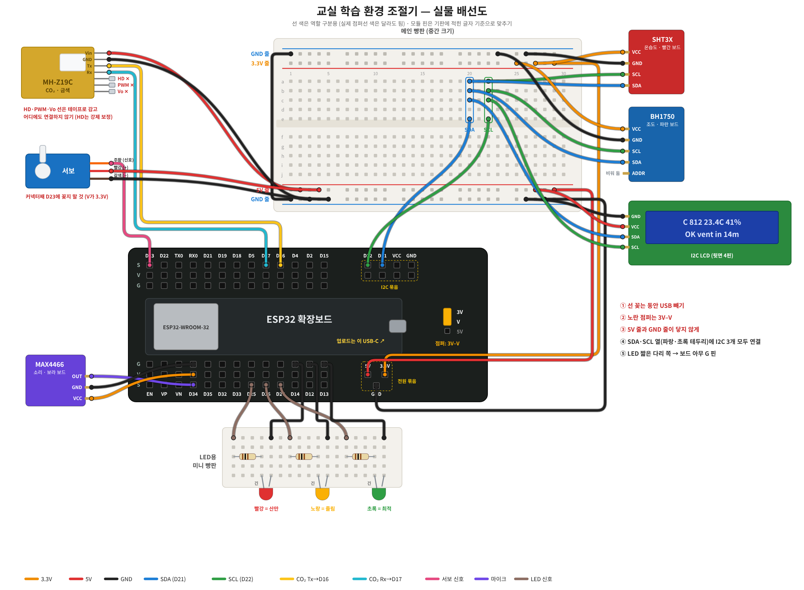
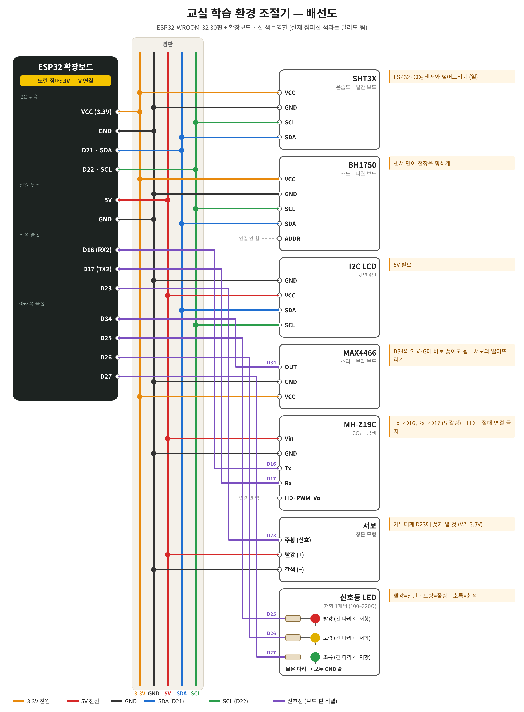

# 교실 학습 환경 조절기

다중 센서와 인공신경망을 활용한 실시간 교실 학습 환경 조절기
20713 김호준 · 2026 인공지능 융합 프로젝트 (SDGs 4 양질의 교육 · 3 건강과 웰빙)

소리·CO₂·조도·온도·습도로 교실의 학습 상태를 **최적 / 졸림 / 산만** 중 하나로 판단해
신호등과 LCD로 알려주고, 웹앱에서 실시간으로 확인·조절합니다.

```
센서 ─▶ ESP32 (10분 특징 → 판단) ─▶ 신호등 · LCD · 서보모터(창문 모형)
              │
              ▼ 10초마다
        Firebase Realtime DB ◀──▶ 깃허브 페이지 웹앱 (상태 확인 · 라벨 기록 · 원격 조절)
              │
              ▼
        tools/export_csv.py ─▶ data/raw/*.csv ─▶ 전처리 · 모델 학습 (노트북)
```

## 폴더 구조

| 경로 | 내용 |
|---|---|
| `firmware/classroom_env/` | ESP32 아두이노 코드 (`classroom_env.ino`, `config.example.h`) |
| `app/index.html` | 웹앱 (깃허브 페이지로 공개) |
| `tools/export_csv.py` | Firebase → CSV 내려받기 |
| `tools/export_mlp.py` | 학습한 인공신경망 → ESP32용 `model_weights.h` |
| `data/raw/` | 내려받은 원본 CSV (`datasci_co2_20261102.csv` = 데이터과학 장치 사전 측정) |

---

## 1. 배선 (ESP32-WROOM-32 30핀 + 확장보드)



<details><summary>연결 관계도 (선 역할별)</summary>



</details>

| 부품 | 부품 핀 → ESP32 |
|---|---|
| MAX4466 (소리) | VCC → **3.3V**, GND → GND, OUT → **D34** |
| MH-Z19C (CO₂) | Vin → **5V**, GND → GND, TX → **D16**, RX → **D17** |
| BH1750 (조도) | VCC → 3.3V, GND → GND, SDA → **D21**, SCL → **D22** (ADDR 핀은 비워 둠) |
| SHT (온습도) | VCC → 3.3V, GND → GND, SDA → **D21**, SCL → **D22** |
| I2C LCD 1602 | VCC → **5V**, GND → GND, SDA → **D21**, SCL → **D22** |
| 신호등 LED 모듈 | R → **D25**, Y → **D26**, G → **D27**, GND → GND |
| 서보모터 (창문 모형) | 신호(주황/노랑) → **D23**, 빨강 → **5V**, 갈색/검정 → GND |
| 창문 리드 스위치 (선택) | 한쪽 → D13·D14·D18·D19·D32·D33·D4·D5 순서, 다른 쪽 → GND |

- I2C 장치 3개(LCD, BH1750, SHT)는 SDA·SCL 선을 함께 씁니다. 주소가 서로 달라서 충돌하지 않아요(0x27 / 0x23 / 0x44).
- 확장보드의 노란 점퍼는 각 핀 옆 **V** 줄의 전압(3.3V/5V)을 정합니다. 센서마다 필요한 전압이 다르니 **3.3V·5V 전원 핀에서 따로 연결**하세요.
- 서보가 움직일 때 ESP32가 재부팅되면 USB 전원이 부족한 거예요. 서보 5V·GND 사이에 100µF 이상 콘덴서를 달거나 5V 2A 어댑터를 쓰세요.
- MAX4466 뒷면의 작은 가변저항은 증폭률입니다. 조용할 때 `snd_mean`이 너무 작으면(20 이하) 시계 방향으로 돌려 키우세요.

## 2. Firebase 준비 (처음 한 번)

1. [Firebase 콘솔](https://console.firebase.google.com)에서 프로젝트 만들기
2. **빌드 → Realtime Database → 데이터베이스 만들기** (위치: 싱가포르 `asia-southeast1`, 잠금 모드)
3. **규칙** 탭에 아래를 붙여넣고 게시. 읽기는 공개(웹앱·선생님 확인용), 쓰기는 비밀번호가 있어야 가능.
   ```json
   { "rules": { ".read": true, ".write": false } }
   ```
4. **프로젝트 설정 → 서비스 계정 → 데이터베이스 비밀번호(Database secrets)**에서 비밀번호 복사
5. 데이터베이스 주소(`https://…firebasedatabase.app`) 복사

## 3. 펌웨어 업로드

1. 아두이노 IDE → 보드 매니저에서 **esp32 by Espressif** 설치, 보드는 **ESP32 Dev Module**
2. 라이브러리 매니저에서 설치
   - `BH1750` (Christopher Laws)
   - `LiquidCrystal I2C` (Frank de Brabander)
   - `ArduinoJson` (Benoit Blanchon, **7.x**)
   - `ESP32Servo` (Kevin Harrington)
   - SHT 모델에 맞게 `Adafruit SHT31 Library` 또는 `Adafruit SHT4x Library`
3. `config.example.h`를 복사해 **`config.h`**로 이름을 바꾸고 와이파이·Firebase 주소·비밀번호·SHT 모델을 입력
4. 업로드 후 시리얼 모니터(115200)에서 `SHT:OK BH1750:OK`와 10초마다 찍히는 기록을 확인
5. 처음 켜면 빨-노-초 LED가 한 번씩 켜집니다. CO₂는 **3분 예열** 동안 `flag: warmup`으로 기록되고 판단에서 빠집니다.

## 4. 웹앱 배포 (깃허브 페이지)

1. `app/index.html` 맨 아래 `DB_URL`을 내 Firebase 주소로 바꾸기
2. 저장소 **Settings → Pages → Branch: main / (root)** 저장
3. `https://<아이디>.github.io/<저장소>/app/`로 접속 (학교 패드 브라우저에서도 동작)
4. 처음 한 번 **원격 조절 → 쓰기 키 설정**에 Firebase 비밀번호를 저장해야 기록·조절이 가능합니다. 이 키는 그 기기 브라우저에만 저장되고 깃허브에는 올라가지 않아요.

## 5. 데이터 수집 방법

- 장치는 10초마다 기록 1개를 올립니다. CO₂·온습도·조도는 1초마다 재서 평균을 내고, 소리는 50ms 단위로 계속 잽니다.
- 자습 시간에 **10분마다** 웹앱에서 집중도(1~5), 졸림(1~5), **엎드려 자는 학생 수**를 기록합니다.
- 라벨 규칙: 집중도 ≥ 4 → 최적(0), 졸림 ≥ 4 → 졸림(1), 그 외 → 산만(2)
- 수집이 끝나면 CSV로 내려받습니다.
  ```bash
  python tools/export_csv.py --url https://…firebasedatabase.app --since 2026-11-11
  ```

### 기록 형식 (`logs`)

| 열 | 뜻 |
|---|---|
| `ts`, `time` | 측정 시각 (유닉스 시간, 한국 시간) |
| `flag` | `warmup` = CO₂ 예열 중(분석에서 제외), `ok` |
| `co2` | CO₂ ppm (10초 평균) |
| `temp`, `hum`, `lux` | 온도 ℃, 습도 %, 조도 lx |
| `snd_mean`, `snd_std`, `snd_max` | 50ms 진폭(ADC)의 평균·표준편차·최댓값 — 크기와 변동성 |
| `snd_spikes` | 배경보다 2배 이상 튄 소리의 횟수 (말소리·충격음) |
| `reed` | 창문 리드 스위치 상태 문자열 (1 = 열림) — pandas에서 `dtype={"reed": str}`로 읽기 |
| `state`, `vent`, `win` | 장치 판단(0 최적, 1 졸림, 2 산만), 환기 알림, 창문 모형(서보) 열림 여부 |

## 6. 판단 방식

**수집 기간 (USE_MLP 0) — 임시 규칙**
- **환기 알림:** 최근 5분 CO₂ 기울기(최소제곱법)로 졸음 임계값까지 남은 시간을 예측합니다. 10분 이내이면 알림을 켜고, 1,000ppm 이하가 되면 끕니다(히스테리시스).
- **산만:** 최근 1분의 소리 급증 횟수가 기준 이상이면 켜지고, 기준의 절반 이하가 되면 꺼집니다.
- 조도·온도·습도는 학교보건법 시행규칙 기준(300lx 이상, 18~28℃, 30~80%)으로 원인을 표시합니다.
- 환기 알림이 켜지면 서보모터가 창문 모형을 엽니다(0° → 90°, 코드 위쪽 `SERVO_OPEN`으로 조정). 웹앱에서 자동/열기/닫기를 고를 수 있어요.
- 모든 기준값은 웹앱 **원격 조절**에서 바꿀 수 있고, 30초 안에 장치에 반영됩니다.

**학습 후 (USE_MLP 1) — 인공신경망**
- 최근 10분 특징 8개 `snd_mean, snd_std, snd_spikes, co2_mean, co2_slope, lux, temp, hum`를 z-점수로 표준화해서 MLP(은닉층 2개, ReLU)에 넣습니다.
- 노트북에서 `MLPClassifier(hidden_layer_sizes=(16, 8))`로 학습한 뒤 아래를 실행하고, `config.h`에서 `USE_MLP 1`로 바꿔 다시 업로드합니다.
  ```python
  from tools.export_mlp import export_mlp
  export_mlp(model, scaler, "firmware/classroom_env/model_weights.h")
  ```
- 상태는 인공신경망이 정하고, 원인 설명(LCD·웹앱)은 규칙이 붙입니다.

## 7. 데이터과학 장치와 합치기 (선택)

MH-Z19C와 창문 리드 스위치를 이 장치로 옮기면, 하나의 장치가 두 과목의 데이터를 모두 기록합니다.
`config.h`의 `REED_COUNT`를 스위치 개수로 바꾸면 `reed` 열에 저장됩니다.

## 8. 오류 수정 기록

| 날짜 | 문제 | 원인 | 해결 |
|---|---|---|---|
| | | | |
